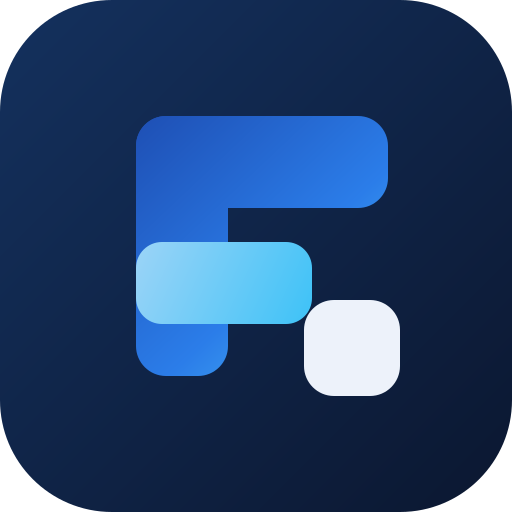
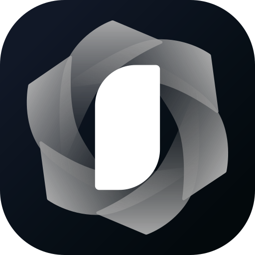
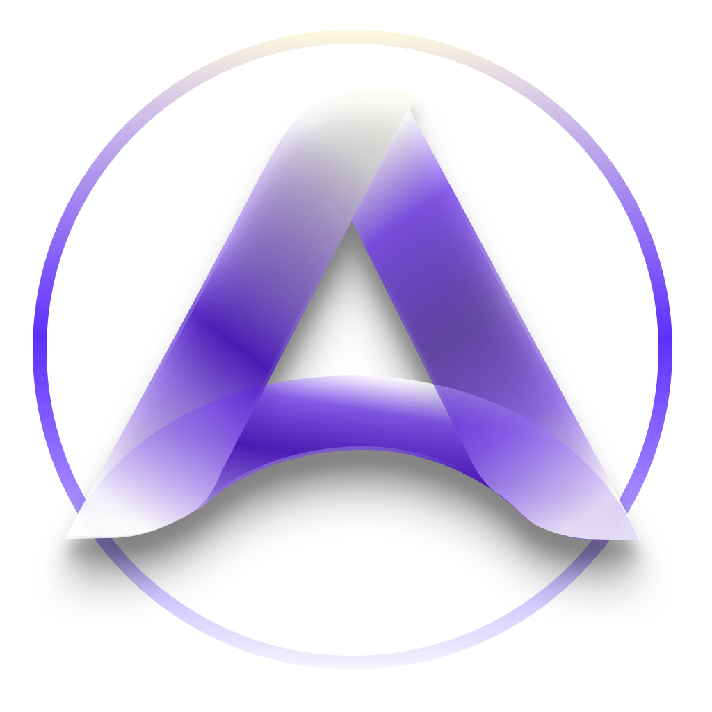
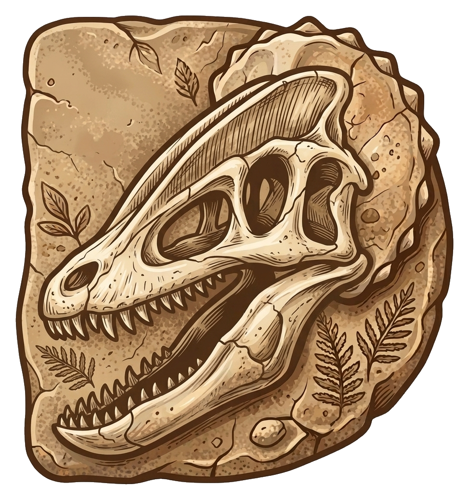
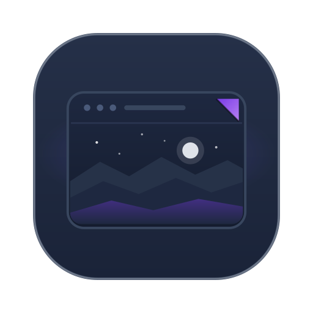
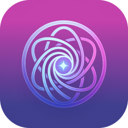
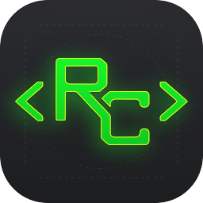
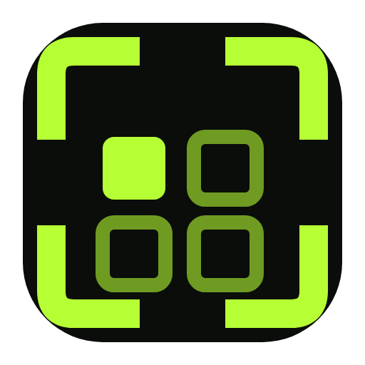
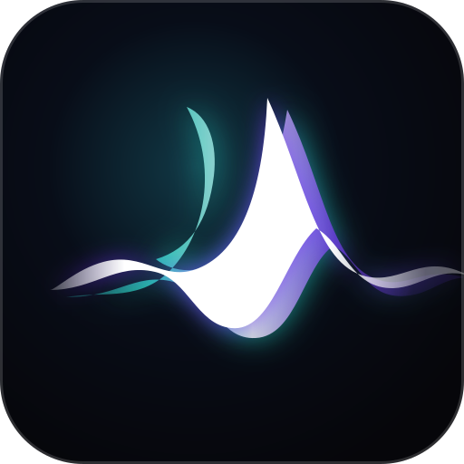

# Matheus Pereira

Software Engineer | Frontend | Web, Data & IoT

## About

Software Engineer focused on frontend, with experience across web interfaces, data workflows, automation, and IoT. I build practical tools and experiments with an emphasis on readable interfaces, performance, accessibility, and codebases that stay easy to evolve.

Most of my public repositories are personal projects built end to end, from interface design and application architecture to deployment and maintenance. They are open source studies and utilities rather than commercial products, but I keep the public demos and descriptions aligned with what each project currently does.

**Areas of Expertise:**

* Frontend applications with React, TypeScript, and JavaScript
* Backend APIs, automation, and integration workflows
* Data analysis and visualization
* Embedded systems and IoT prototyping

---

## Main Projects

The following projects focus on technical exploration, interface work, and useful browser-first tooling.

| Visual | Project | Description | Links |
| --- | --- | --- | --- |
|  | **Fremit** | Code mockup editor with theme support and high-resolution export. | [Demo](https://mafhper.github.io/fremit/) · [Repository](https://github.com/mafhper/fremit) |
|  | **Icon Core** | Open-source workspace for creating, adjusting, and exporting app icons for web and desktop projects. | [Demo](https://mafhper.github.io/icon-core/) · [Repository](https://github.com/mafhper/icon-core) |
|  | **Imaginizim** | Client-side image optimizer focused on performance and privacy. | [Demo](https://mafhper.github.io/imaginizim/) · [Repository](https://github.com/mafhper/imaginizim) |
|  | **Mark-Lee** | Desktop Markdown editor focused on writing flow, real-time preview, and polished PDF export. | [Demo](https://mafhper.github.io/mark-lee/) · [Repository](https://github.com/mafhper/mark-lee) |
|  | **Personal News** | Privacy-focused news aggregator with clean design and local-first AI support. | [Demo](https://mafhper.github.io/personalnews/) · [Repository](https://github.com/mafhper/personalnews) |
|  | **Push_** | Earlier GitHub dashboard experiment for monitoring repositories, CI/CD failures, security alerts, and activity. | [Demo](https://mafhper.github.io/push_/) · [Repository](https://github.com/mafhper/push_) |

## Secondary / Dev Interest

The list includes earlier experiments and supporting tools that are still useful references.

| Visual | Project | Description | Links |
| --- | --- | --- | --- |
|  | **AuraWall** | Abstract wallpaper generator with gesture support and dynamic color systems. | [Demo](https://mafhper.github.io/aurawall/) · [Repository](https://github.com/mafhper/aurawall) |
|  | **Dinopad** | Mobile-first interactive atlas for exploring deep time, fossils, evolution, and the history of life. | [Demo](https://mafhper.github.io/dinopad/) · [Repository](https://github.com/mafhper/dinopad) |
|  | **Kaes Keide Inspector** | Browser extension for inspecting CSS, HTML, accessibility, assets, and site technology stacks. | [Demo](https://mafhper.github.io/kaes-keide-inspector/) · [Repository](https://github.com/mafhper/kaes-keide-inspector) |
|  | **Landing Starter** | Landing page starter with a subtractive navbar, dark and light themes, and latest-release downloads through a lightweight Cloudflare Worker. | [Demo](https://mafhper.github.io/landing-starter/) · [Repository](https://github.com/mafhper/landing-starter) |
|  | **Portfolio** | Multilingual portfolio site built with React, Vite, TypeScript, Tailwind CSS, and i18next. | [Demo](https://mafhper.github.io/) · [Repository](https://github.com/mafhper/mafhper.github.io) |
|  | **MicroHub** | Local Windows hub for ESP32 and Pico Pi boards running MicroPython: CRUD, dashboard, and simulation. | [Repository](https://github.com/mafhper/micro-hub) |
|  | **Nebula** | Shader-first WebGL showcase and playground with reusable React GPU effects and curated presets. | [Demo](https://mafhper.github.io/nebula/) · [Repository](https://github.com/mafhper/nebula) |
|  | **Release Core** | Reusable GitHub Actions release protocol for web, browser extension, and desktop/Tauri projects. | [Repository](https://github.com/mafhper/release-core) |
|  | **Soft Puk** | Fully offline Android camera reader and solver for the Breach Protocol minigame in Cyberpunk 2077. | [Repository](https://github.com/mafhper/soft-puk) |
|  | **Sonara Hub** | Local creative studio to organize audio packages and generate reactive ambient videos from your albums, without uploads or cloud dependency. | [Demo](https://mafhper.github.io/sonara_hub/) · [Repository](https://github.com/mafhper/sonara_hub) |
|  | **Spread** | Tool for creating and sharing visually rich content cards. | [Demo](https://mafhper.github.io/spread/) · [Repository](https://github.com/mafhper/spread) |

*"I use these projects to explore useful interfaces, practical tooling, and a free, accessible web."*
